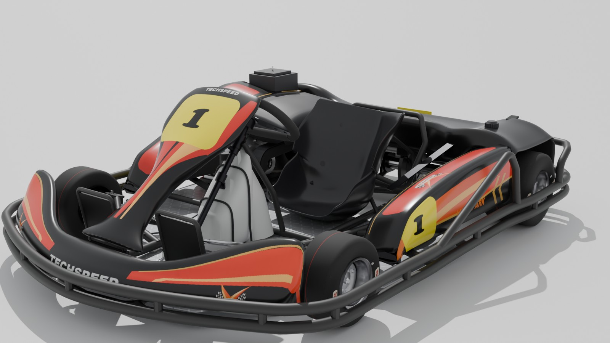
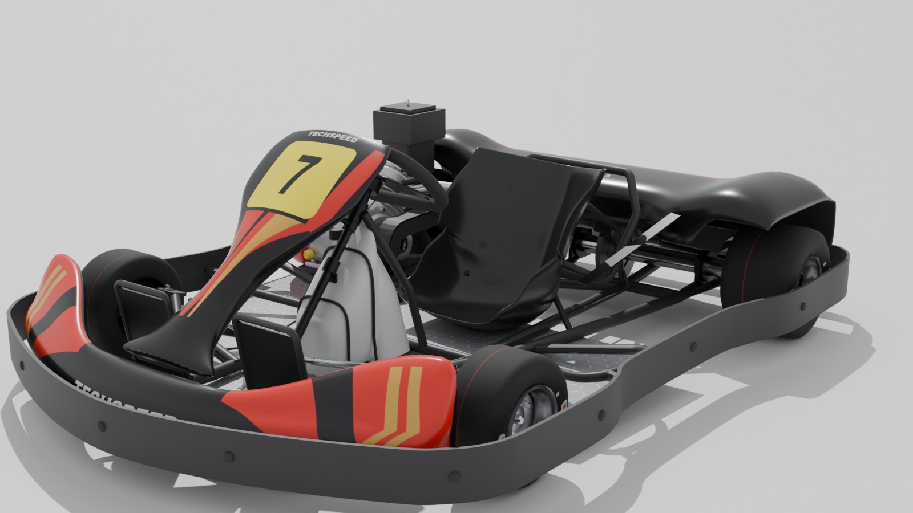
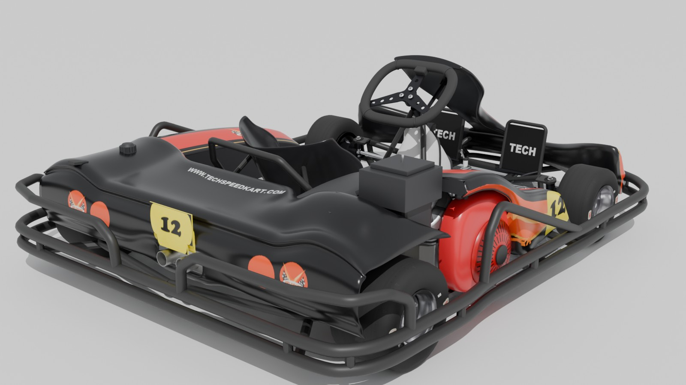
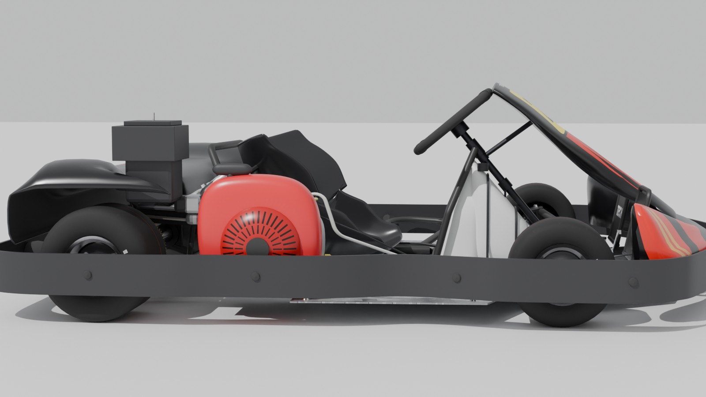
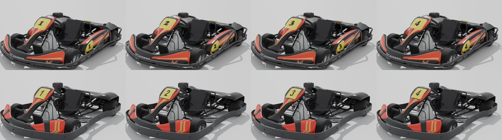

# techspeed-kart

The Techspeed rental karts from Velopark, Brazil, for Assetto Corsa and BeamNG.drive. Both versions of the rental
are here: the v2 with the steel tube protector, and the earlier v1 with the rubber band. Each comes with three Honda
engines (9, 11 and 13 hp). They are modelled from photos of the real karts and drive like them: one gear, a
centrifugal clutch, a governed engine and a solid rear axle.

| | |
|---|---|
|  |  |
|  |  |

## Karts

| Kart | Engine | Top speed | Weight with driver | Brakes |
|---|---|---|---|---|
| Techspeed Rental v2 9hp | Honda GX270 | ~78 km/h | 190 kg | rear |
| Techspeed Rental v2 11hp | Honda GX340 | ~80 km/h | 195 kg | rear |
| Techspeed Rental v2 13hp | Honda GX390 | ~82 km/h | 196 kg | rear |
| Techspeed Rental v1 9hp | Honda GX270 | ~78 km/h | 182 kg | rear |
| Techspeed Rental v1 11hp | Honda GX340 | ~80 km/h | 187 kg | rear |
| Techspeed Rental v1 13hp | Honda GX390 | ~82 km/h | 188 kg | rear |

- **Rental v2:** the steel tube protector all round, side pods, an engine cover, the fuel filler in the left pod and
  a ballast box beside it.
- **Rental v1:** a flat protector band on rubber buffers, no side pods and the engine in the open.

In BeamNG.drive the three rentals of each version share one chassis, so they weigh the same there (190 kg v2,
182 kg v1).

Every kart comes in its fleet's livery, karts 1 to 36, as photographed at the track. The v2 is gloss black with red
and orange flames, and the v1 black, red and gold, both with the Velopark logos and yellow number plates. Every third
kart runs on worn tyres.

## Installing

Download the archives from the [releases page](https://github.com/albertowd/techspeed-kart/releases).

- **Assetto Corsa:** extract `techspeed-kart-<version>-ac.7z` into your `assettocorsa` folder. It adds six cars,
  `techspeed_rental_*`, to `content/cars`. In the game they are listed as Techspeed Rental.
- **BeamNG.drive:** put `techspeed-kart-<version>-beamng.zip` as it is in BeamNG's `mods` folder
  (`%LOCALAPPDATA%\BeamNG\BeamNG.drive\current\mods`). Pick Techspeed Kart in the vehicle list; the six rentals are
  its configurations.

The karts were made for the Techspeed Velopark track, also on overtake.gg.

### Assetto Corsa needs Custom Shaders Patch

The karts run in plain Assetto Corsa, but with [Custom Shaders Patch](https://acstuff.club/patch/) they get:

- One gear, as on the real kart: no neutral or reverse. Without CSP the gearbox still has N and R; select first gear
  to move.
- Clutch heat (see below).
- The engine sounding louder from the cockpit than from outside, and the pedals and the driver's feet moving.

## Driving them

- **One gear and a centrifugal clutch.** Open the throttle and the clutch starts to bite at 2200 rpm and locks at
  2800 rpm (~53 km/h). Lift off and it lets go. There is no clutch pedal and nothing to shift.
- **The clutch heats up while it slips.** Standing starts, and corners taken so slowly that the clutch has to slip
  on the way out, warm it up; it cools in the air. From 200 °C it loses grip, and at 320 °C it's ruined. Take the
  slow corners with some speed and it stays well below that. BeamNG.drive shows a warning at 150 °C; in Assetto
  Corsa the temperature shows in CSP's Lua debug app.
- **The engine has a speed governor**, so each kart has a fixed top speed (see the table above).
- **Fuel:** as at the track, a rental runs two 25-minute heats on one tank. A full 6 l tank lasts ~55 min on the 9hp
  and ~45 min on the 13hp, and the 4 l the karts start with lasts a heat. The AI in Assetto Corsa plans its fuel
  from the same figures.
- **Brakes on the rear axle only**, as on the real rentals.

## Known issues

- The physics are a first version, not yet tuned by driving.
- BeamNG.drive: the steering wheel's direction and the driver camera still need a look.
- No lower-detail models (LODs) for far-away karts and no damage model.

## Credits

- Assetto Corsa sounds and the starting point of the physics: the GoKart 0.5c mod by mclarenf1papa, bobskype, Lunae
  and SimonTek.
- BeamNG.drive engine sounds: the game's own samples.

To build the karts from source or work on them, see [CONTRIBUTING.md](CONTRIBUTING.md).
